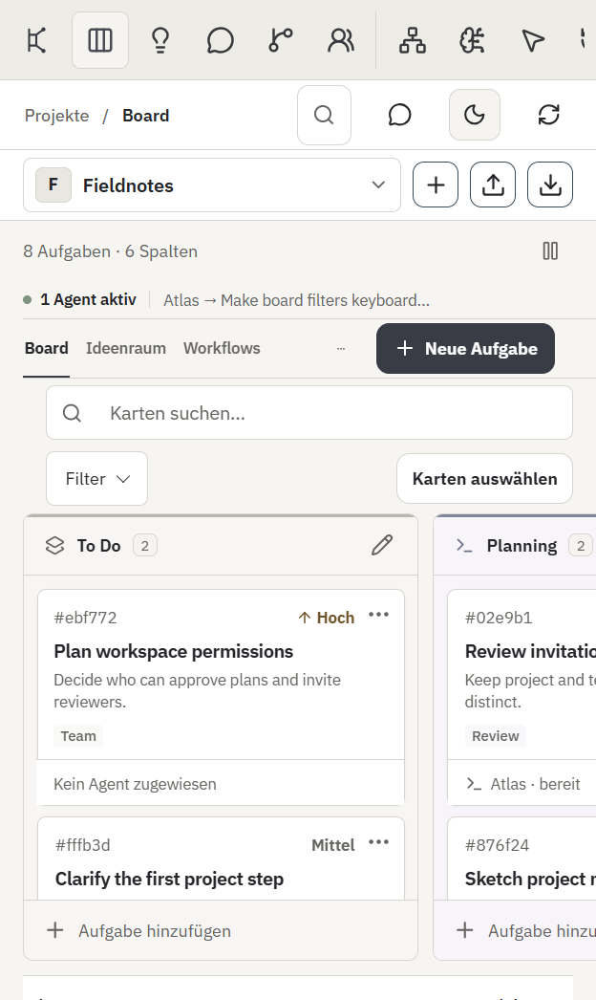
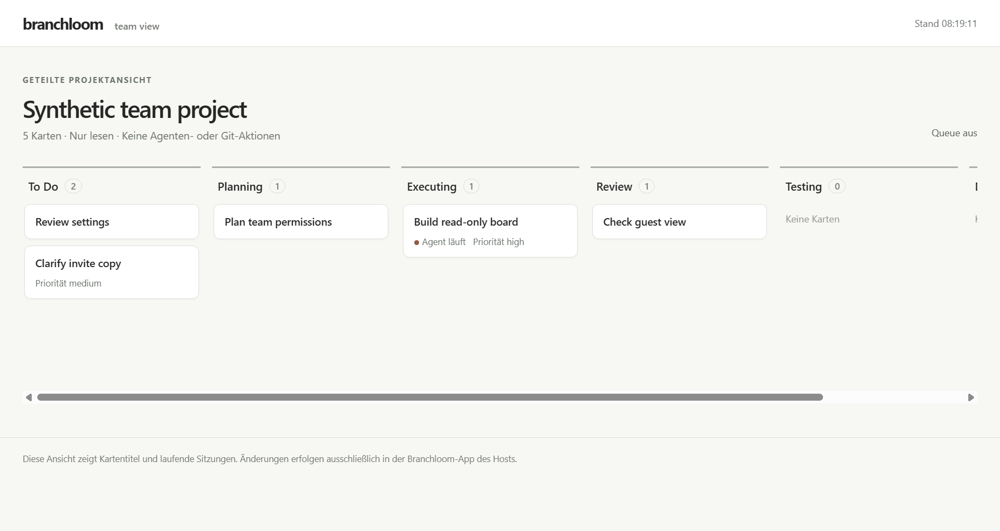
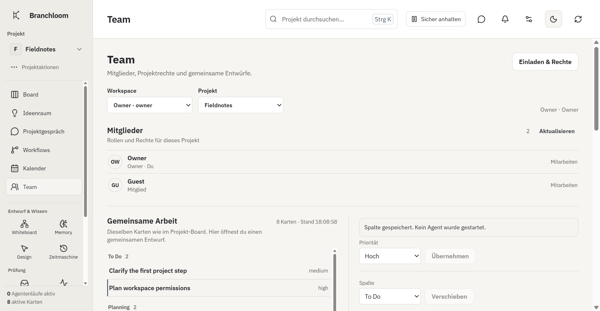
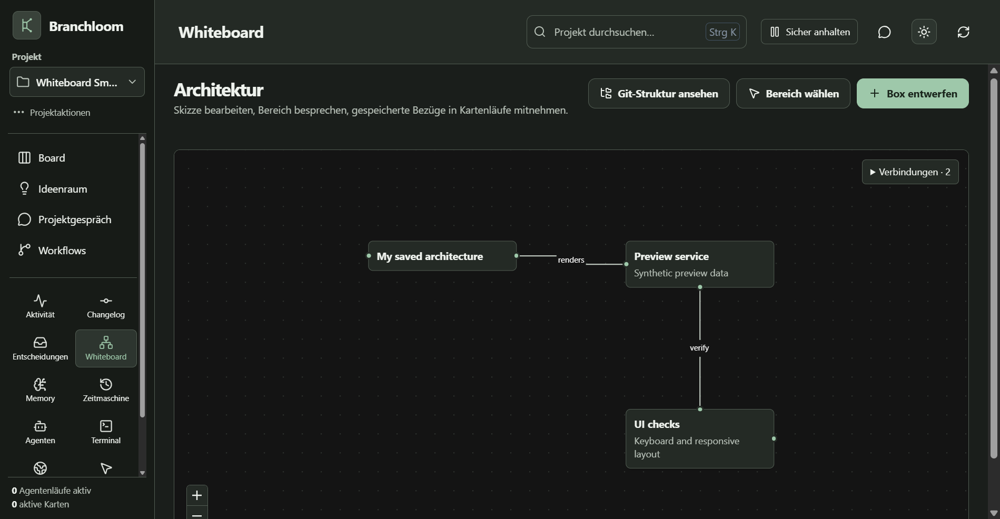

# Branchloom

**Plan the work, run local coding assistants, and review what they changed.** Branchloom is a Windows desktop workspace that keeps a project's board, visual plan, agent sessions, design drafts, and review evidence together. A card can be discussed before it becomes work; a finished agent run can be checked before its code is integrated.

*A board in the current light appearance. This image uses generated tasks, a simulated running session, and sample output to show the session rail; no CLI process or user account is involved. Other screenshots below also use disposable project data.*

Board in a narrow window

### From an idea to a checked result

1. **Capture and shape the work.** Collect an idea, discuss it in Project Chat, or create a card. The board records its current step; the Whiteboard can show related project parts and saved links.
2. **Choose how it runs.** Assign an installed CLI assistant to a task or workflow. Independent tasks can run in separate Git worktrees, which are Git-managed copies of the project.
3. **Stay in control.** See active sessions, answer agent questions, pause new work, and inspect the proposed changes and recorded checks. You decide when code is integrated.

Branchloom is an early Windows preview. The interface and detailed feature docs are currently mostly in German. The [product vision](docs/PRODUCT_VISION.md) describes the destination; [current status](docs/STATUS.md) and the [parity list](docs/PARITY.md) distinguish working paths from planned ones. Jarvis, the personal assistant, is a separate project.

## What works today

| Area | Current path |
| --- | --- |
| **Plan work** | Import an existing local Git project, capture ideas, create and filter board cards, set priorities and labels, and configure columns and workflows. Active or paused workflows can show recorded per-card step progress on the board. The official Windows installer includes Trello sign-in; a custom package needs its own [Trello app setup](docs/IMPORT.md). |
| **Run agents** | Assign an installed CLI agent to a column or task. Branchloom starts local sessions, records their output, shows active runs under the board, and can run independent cards in separate Git worktrees. Agent availability and model access depend on the CLI installed and signed in on your machine. |
| **Keep context** | Search locally indexed tasks, completed runs, Git commits, and code passages. The Memory graph opens at a source with saved links and lets you inspect one or two relationship steps or the full current excerpt; it does not infer semantic links from prose. Project Chat can answer from indexed sources and prepare editable card or Whiteboard drafts. Saving either draft requires a click. |
| **Shape the UI** | Open a project Design overview of saved wireframes, local QA screenshots, and captured app elements. QA images are dated evidence from earlier browser checks, not editable drafts. Edit a card wireframe across desktop, tablet, and mobile artboards, with layers, properties, and explicit save and approval. A separate view inspects an explicitly opened local dev page and collects element, CSS, component, and token references. A saved wireframe reaches an agent only after separate approval. |
| **Review and verify** | Inspect diffs, attach acceptance and QA evidence, run bounded browser checks against a local route, compare saved screenshots, and use the manual integration queue. A [screenshot review](docs/TEAM_REVIEW.md) can show the same saved image and point comments in two browser views, with an optional, explicitly started Tailscale link for a peer. Its Git checkout comparison flags a changed HEAD or dirty checkout; it does not identify the files served by the dev server. Evidence is shown with its source and limits. |
| **Replay a UI bug** | Record a few clicks and viewport changes in a local card preview, set a visible or hidden element as the expected result, then explicitly replay the saved steps in an isolated check. [Scope and limits](docs/BUG_REPLAY.md). |
| **Share a board view** | Create a separate, revocable link for each guest in project settings. The default link only shows current columns, card titles and running-session signals; an explicit option also lets that guest comment on cards. The host sees feedback in the Decision Inbox and on the relevant card. Local and optional Tailscale links are available. [Setup and limits](docs/TEAM_BOARD.md). |
| **Try a local team workspace** | On one laptop, an owner can create a workspace, add more local projects, invite another authenticated app profile, and collaborate on a separate card draft. A newly added project is private to the owner until members receive explicit project access. The owner can narrow access or separately grant task controls and agent start per member. An authorized move into an auto-start column starts the configured CLI on the host in its own Git worktree; duplicate requests do not launch it twice. A draft edit cannot change the accepted card or start an agent. This is a [local preview](docs/TEAM_LOCAL_PREVIEW.md), not cross-device hosting. |
| **Control the run** | Review the queue's route, next tasks and rights before starting; a change to that review blocks the start until checked again. Pause a project or workflow at a checked boundary, review agent questions in the Decision Inbox, and inspect local activity and usage counts. An optional project queue setting defers blocked cards and continues with independent To-Do work. Choose a 1, 4, or 8 hour window, or type a local end time such as `bis 20 Uhr` in the Workflow view. The German Project Chat command `arbeite bis 20 Uhr` opens the same start review; it does not silently start an agent. The deadline stops new queue work without killing an active agent. Another opt-in setting checks each completed card's committed worktree with an approved npm script before claiming the next card. This setting alone does not merge or push; a separately enabled automatic integration policy can act when its own review and test checks pass. A local queue history links claimed cards to their workflows, last recorded sessions, saved diff reviews, and the start that ran an automatic npm test when that provenance was saved. Separate per-project settings can explicitly grant full access to new Codex workflow steps; this affects the CLI process, not Branchloom's review, integration, or push gates. The installed app offers a GitHub release update only after you choose **Update**. |

During an active queue, the launch settings of agents and columns used by its route remain fixed until you pause the queue. New automatic column starts cannot be enabled mid-run.

**Where it is going:** The [team design](docs/TEAM_SYNC.md) targets colleagues on separate devices, shared Whiteboards, explicit plan approvals, and a decision dashboard. Today's team coordinator listens only on `127.0.0.1`; agent workers and worktrees still run on the host machine. Live draft presence and event-driven updates work between two local app profiles; cursor sharing and remote hosting are still open.

### A look inside

A guest board view

This is an actual Electron browser view generated from synthetic project data. Each guest has an individual link that the host can revoke. [How sharing works](docs/TEAM_BOARD.md).

Local team workspace

The screenshot shows the owner profile after a second, separately authenticated client contributed text. The draft remains separate from the accepted card description. [Two-profile walkthrough and limits](docs/TEAM_LOCAL_PREVIEW.md).

Whiteboard and project context

On the Whiteboard, you can select saved boxes for a source-backed explanation and sketch nodes or connections before saving them. Saved links can provide bounded context to related card agents and workflow planning. Memory separately indexes tasks, runs, commits, and code passages with inspectable source links. [Memory](docs/MEMORY.md) · [Whiteboard](docs/WHITEBOARD.md).

Project Chat and design workspace

Project Chat searches indexed project sources and can prepare an editable card or Whiteboard proposal. Its answer depends on the installed and signed-in CLI agent. In Design, you can start with a blank artboard or a simple window template, then edit layers and properties across desktop, tablet, and mobile sizes. A separate inspection view can examine a running local app and prepare a task from a tested visual change. Saving a draft, approving it, and starting an agent are separate actions. [Project Chat](docs/PROJECT_CHAT.md) · [Wireframes](docs/CARD_WIREFRAME.md) · [Design inspection](docs/DESIGN_INSPECTION.md).

## Get started on Windows

For a regular install, download the installer from the [latest GitHub release](https://github.com/mschr703/branchloom/releases/latest). Windows packages are currently unsigned. The installed app checks for published updates; the portable build and source checkout do not update themselves. See [release and package details](docs/RELEASE.md). A release can trail the source checkout; check its notes for the exact included features.

To run the current source, use **Windows 11, Node.js 24, and Git**. If a native dependency has no matching prebuilt binary, you may also need the Visual Studio C++ Build Tools.

~~~powershell
git clone https://github.com/mschr703/branchloom.git
Set-Location branchloom
npm ci
npm run doctor
npm run dev
~~~

The doctor command checks local prerequisites and CLI paths; it does not verify sign-in or model credits. The dev command starts Vite on 127.0.0.1:5181 and opens Electron. Stop it with **Ctrl+C** in that terminal. For a production source build, run npm run build followed by npm start.

In the app:

1. Add an **existing local code folder** as a project using **Choose folder**. A Git repository is needed for separate worktrees and parallel agent runs.
2. Create a card on the board, or connect Trello and import selected cards.
3. Install and sign in to the CLI you want to use. Codex CLI has been exercised on the development machine; check [agent diagnostics](docs/AGENT_DIAGNOSTICS.md) for the other adapters.
4. Configure an agent on a column, then deliberately start a card. Review its session, worktree, diff, and test or browser QA evidence before integrating changes.

Optional voice input uses Python 3.13 and a local Whisper model; the core app runs without it. [Voice setup](docs/VOICE.md).

## Boundaries that matter

Branchloom stores project metadata locally in SQLite. Agent calls use the separately installed CLI and its configured provider; review the context and permissions before starting a run. Browser access for agents is off by default and limited to an explicitly approved local development address. App previews and agent browser checks are separate. [Browser permissions](docs/AGENT_BROWSER.md).

The local **safe pause** blocks new project work and waits for active runs to finish; it does not silently kill a running agent or restart interrupted work after a network outage. [Pause behavior](docs/PROJECT_PAUSE.md) · [Session recovery](docs/SESSION_RECOVERY.md).

Usage shows recorded runs and known duration, **not** estimated tokens or provider cost. A QA screenshot or Git HEAD is evidence of a bounded check, not proof that every interaction passed. [Activity and usage](docs/ACTIVITY.md) · [QA scope](docs/CARD_QA.md).

Cross-device team hosting, live Whiteboard editing, project-admin draft acceptance, and semantic Memory links are still open. The installed update path has been verified for 0.1.0 → 0.1.2 on a fresh Windows runner; other version pairs and code signing remain open. The [parity list](docs/PARITY.md) tracks these and other gaps.

## Documentation and contribution

Start with the [architecture](docs/ARCHITECTURE.md), [repository map](docs/REPO_MAP.md), [workflows](docs/WORKFLOW_STEPS.md), [worktrees](docs/WORKTREES.md), and [release guide](docs/RELEASE.md). Detailed feature behavior lives in the docs directory; [STATUS](docs/STATUS.md) records verified work and remaining limits.

Read [CONTRIBUTING.md](CONTRIBUTING.md) before opening a pull request. External contributions need a separately verified rights agreement before merge; the PR template itself is not an agreement. [Contribution process](docs/CONTRIBUTOR_RIGHTS.md).

## License

The current source is available under [PolyForm Noncommercial 1.0.0](LICENSE). Personal noncommercial use, modification, and redistribution are governed by that license; commercial use needs a separate written license. Earlier MIT releases retain their MIT rights. This is **source available, not OSI open source**. [Licensing details](docs/COMMERCIAL_LICENSING.md).
