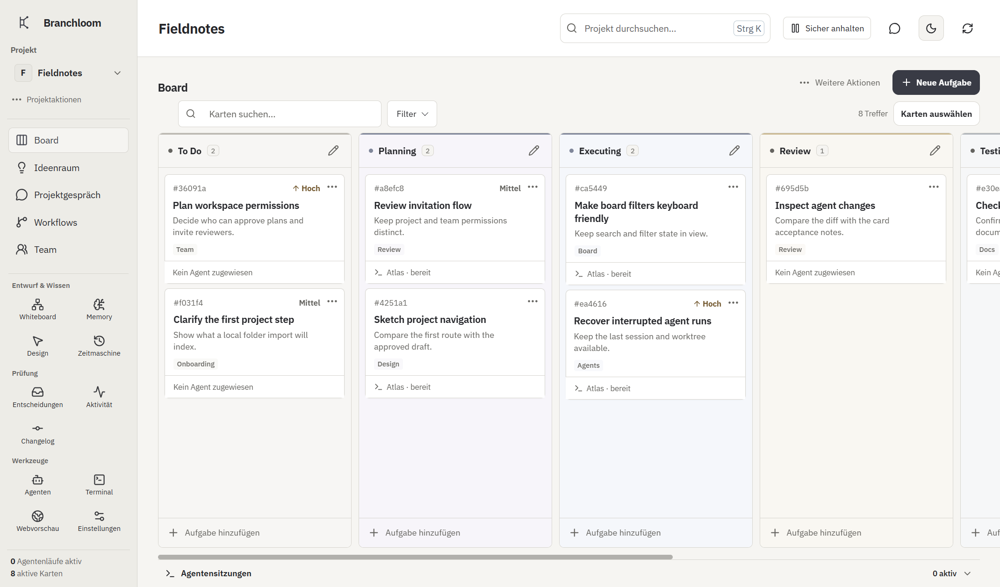
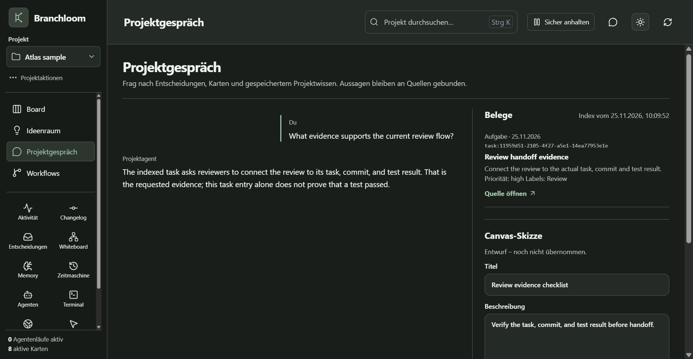
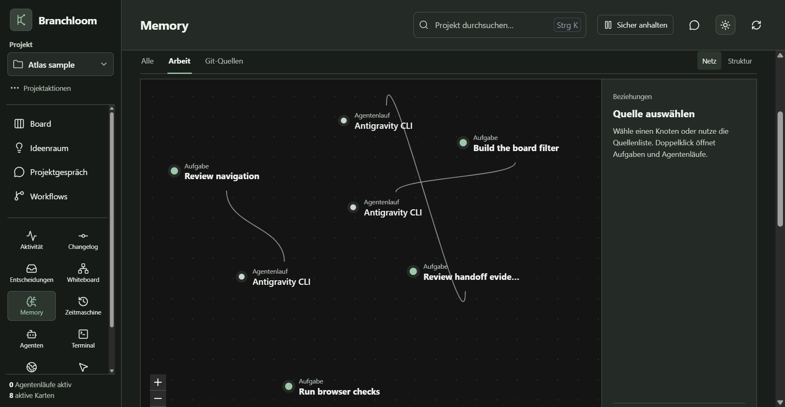
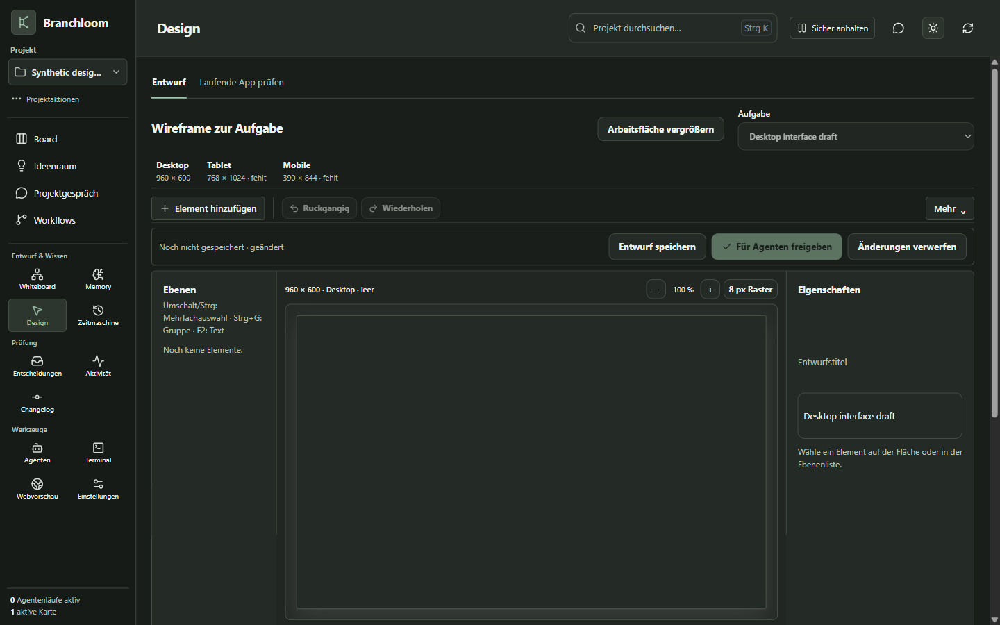
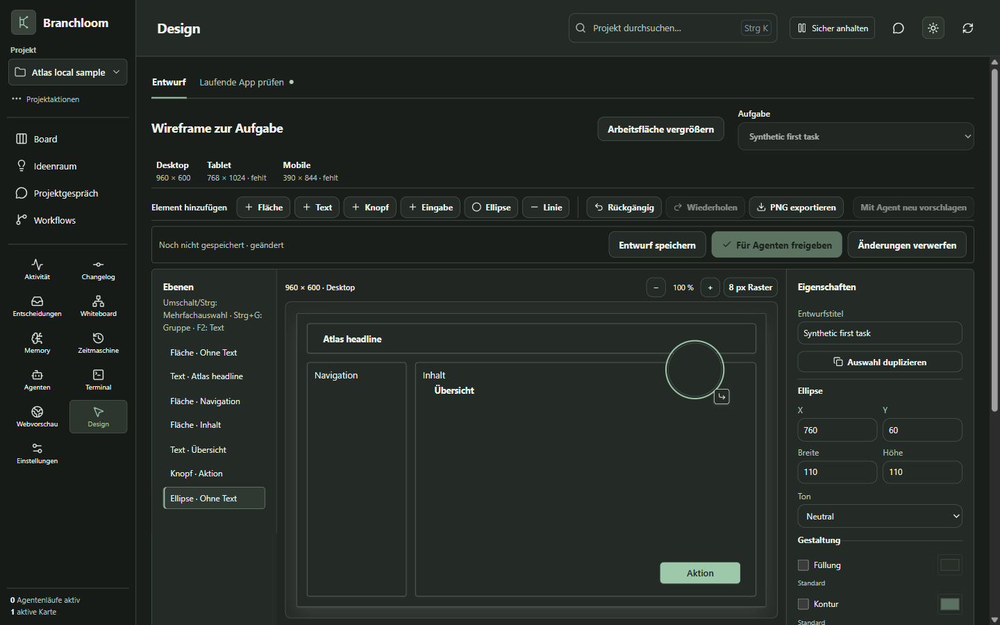

# Branchloom

**A local Windows workspace for turning project ideas into reviewed code.** Branchloom brings tasks, coding assistants, design drafts, and review into one desktop app. You choose when work starts and when its result becomes part of your project.

*The board in a synthetic sample project. All screenshots below use generated tasks and a disposable local Git repository; they contain no user projects or accounts.*

### From an idea to a checked result

1. **Capture an idea** as a note or a board task. Discuss it in Project Chat if it needs a clearer plan.
2. **Choose the next step** on the board or in a workflow. Branchloom shows the task, assigned assistant, and required checks together.
3. **Let a coding assistant work.** Parallel tasks can use separate Git worktrees (Git-managed copies of the project) so they do not edit the same checkout. A CLI agent is an assistant you install and sign in to separately; Branchloom runs that command-line program for the task.
4. **Inspect the result** in the session, the before/after code changes, the design preview, and the test evidence. You decide when to integrate it.

Branchloom is an early Windows preview. The interface and detailed feature docs are currently mostly in German. The [product vision](docs/PRODUCT_VISION.md) describes the destination; [current status](docs/STATUS.md) and the [parity list](docs/PARITY.md) distinguish working paths from planned ones. Jarvis, the personal assistant, is a separate project.

## What works today

| Area | Current path |
| --- | --- |
| **Plan work** | Import an existing local Git project, capture ideas, create and filter board cards, set priorities and labels, and configure columns and workflows. Active or paused workflows can show recorded per-card step progress on the board. The official Windows installer includes Trello sign-in; a custom package needs its own [Trello app setup](docs/IMPORT.md). |
| **Run agents** | Assign an installed CLI agent to a column or task. Branchloom starts local sessions, records their output, shows active runs under the board, and can run independent cards in separate Git worktrees. Agent availability and model access depend on the CLI installed and signed in on your machine. |
| **Keep context** | Search locally indexed tasks, completed runs, Git commits, and code passages. The Memory graph opens at a source with saved links and lets you inspect one or two relationship steps or the full current excerpt; it does not infer semantic links from prose. Project Chat can answer from indexed sources and prepare editable card or Whiteboard drafts. Saving either draft requires a click. |
| **Shape the UI** | Edit a card wireframe across desktop, tablet, and mobile artboards, with layers, properties, and explicit save and approval. A separate view inspects an explicitly opened local dev page and collects element, CSS, component, and token references. A saved wireframe reaches an agent only after separate approval. |
| **Review and verify** | Inspect diffs, attach acceptance and QA evidence, run bounded browser checks against a local route, compare saved screenshots, and use the manual integration queue. A [screenshot review](docs/TEAM_REVIEW.md) can show the same saved image and point comments in two browser views, with an optional, explicitly started Tailscale link for a peer. Its Git checkout comparison flags a changed HEAD or dirty checkout; it does not identify the files served by the dev server. Evidence is shown with its source and limits. |
| **Replay a UI bug** | Record a few clicks and viewport changes in a local card preview, set a visible or hidden element as the expected result, then explicitly replay the saved steps in an isolated check. [Scope and limits](docs/BUG_REPLAY.md). |
| **Control the run** | Pause a project or workflow at a checked boundary, review agent questions in the Decision Inbox, and inspect local activity and usage counts. An optional project queue setting defers blocked cards and continues with independent To-Do work. A selected 1, 4, or 8 hour window stops new queue work at its deadline without killing an active agent. A local queue history links claimed cards to their workflows and last recorded sessions. Separate per-project settings can explicitly grant full access to new Codex workflow steps; this affects the CLI process, not Branchloom's review, integration, or push gates. The installed app offers a GitHub release update only after you choose **Update**. |

**Where it is going:** Branchloom is being built for small teams as well as solo work. Verified team identity and roles, synchronized boards, and coordinated parallel work are planned. Today's parallel agents and worktrees still run locally on one machine; the first screenshot review can be shared with a Tailscale peer, but shared team mode has not shipped.

### A look inside

Project Chat and an editable Canvas draft

The pictured answer is generated by the synthetic screenshot harness, not a real model call. The source panel and draft controls are actual app UI. [How Project Chat works](docs/PROJECT_CHAT.md).

Memory and Whiteboard

Memory indexes saved work and Git sources; its focused graph shows stored links and provides a source inspector. On the Whiteboard, you can select a group of saved boxes for a source-backed explanation and sketch nodes or connections before saving them. Saved Whiteboard links provide bounded context to related card agents and workflow planning. [Memory](docs/MEMORY.md) · [Whiteboard](docs/WHITEBOARD.md).

Design workspace

Start with a blank artboard or a simple window template, then edit elements, layers, and properties. These synthetic drafts are local design sketches, not generated production code. In the separate inspection view, you can select an element of a running local app, test a few visual properties temporarily, and turn the tested change into an editable task. Saving the task and starting an agent remain separate choices. [Wireframes](docs/CARD_WIREFRAME.md) · [Design inspection](docs/DESIGN_INSPECTION.md).

## Get started on Windows

For a regular install, download the installer from the [latest GitHub release](https://github.com/mschr703/branchloom/releases/latest). Windows packages are currently unsigned. The installed app checks for published updates; the portable build and source checkout do not update themselves. See [release and package details](docs/RELEASE.md). A release can trail the source checkout; check its notes for the exact included features.

To run the current source, use **Windows 11, Node.js 24, and Git**. If a native dependency has no matching prebuilt binary, you may also need the Visual Studio C++ Build Tools.

~~~powershell
git clone https://github.com/mschr703/branchloom.git
Set-Location branchloom
npm ci
npm run doctor
npm run dev
~~~

The doctor command checks local prerequisites and CLI paths; it does not verify sign-in or model credits. The dev command starts Vite on 127.0.0.1:5181 and opens Electron. Stop it with **Ctrl+C** in that terminal. For a production source build, run npm run build followed by npm start.

In the app:

1. Add an **existing local code folder** as a project using **Choose folder**. A Git repository is needed for separate worktrees and parallel agent runs.
2. Create a card on the board, or connect Trello and import selected cards.
3. Install and sign in to the CLI you want to use. Codex CLI has been exercised on the development machine; check [agent diagnostics](docs/AGENT_DIAGNOSTICS.md) for the other adapters.
4. Configure an agent on a column, then deliberately start a card. Review its session, worktree, diff, and test or browser QA evidence before integrating changes.

Optional voice input uses Python 3.13 and a local Whisper model; the core app runs without it. [Voice setup](docs/VOICE.md).

## Boundaries that matter

Branchloom stores project metadata locally in SQLite. Agent calls use the separately installed CLI and its configured provider; review the context and permissions before starting a run. Browser access for agents is off by default and limited to an explicitly approved local development address. App previews and agent browser checks are separate. [Browser permissions](docs/AGENT_BROWSER.md).

The local **safe pause** blocks new project work and waits for active runs to finish; it does not silently kill a running agent or restart interrupted work after a network outage. [Pause behavior](docs/PROJECT_PAUSE.md) · [Session recovery](docs/SESSION_RECOVERY.md).

Usage shows recorded runs and known duration, **not** estimated tokens or provider cost. A QA screenshot or Git HEAD is evidence of a bounded check, not proof that every interaction passed. [Activity and usage](docs/ACTIVITY.md) · [QA scope](docs/CARD_QA.md).

Account-based team invitations, shared synchronization, and semantic Memory links are still open. The installed update path has been verified for 0.1.0 → 0.1.2 on a fresh Windows runner; other version pairs and code signing remain open. The [parity list](docs/PARITY.md) tracks these and other gaps.

## Documentation and contribution

Start with the [architecture](docs/ARCHITECTURE.md), [repository map](docs/REPO_MAP.md), [workflows](docs/WORKFLOW_STEPS.md), [worktrees](docs/WORKTREES.md), and [release guide](docs/RELEASE.md). Detailed feature behavior lives in the docs directory; [STATUS](docs/STATUS.md) records verified work and remaining limits.

Read [CONTRIBUTING.md](CONTRIBUTING.md) before opening a pull request. External contributions need a separately verified rights agreement before merge; the PR template itself is not an agreement. [Contribution process](docs/CONTRIBUTOR_RIGHTS.md).

## License

The current source is available under [PolyForm Noncommercial 1.0.0](LICENSE). Personal noncommercial use, modification, and redistribution are governed by that license; commercial use needs a separate written license. Earlier MIT releases retain their MIT rights. This is **source available, not OSI open source**. [Licensing details](docs/COMMERCIAL_LICENSING.md).
